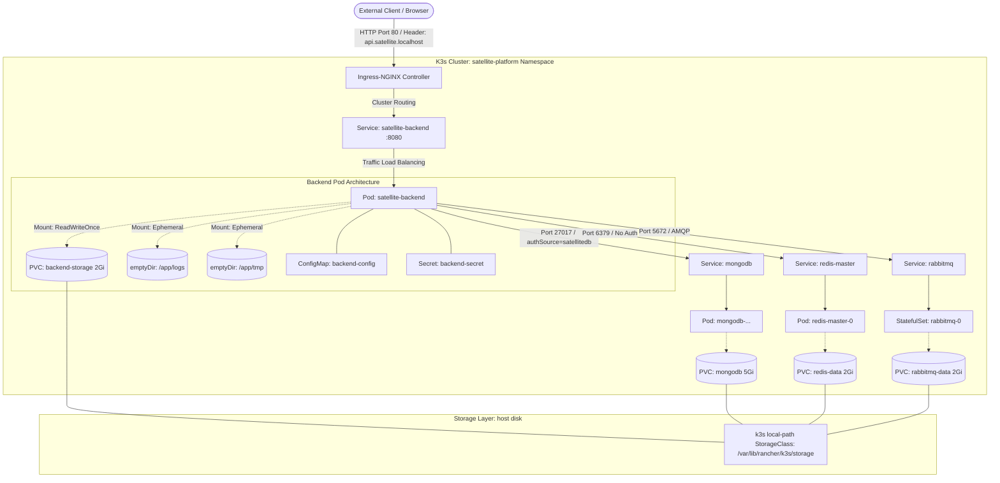

# 🏛️ Architecture Decision Records (ADR) & Interview Guide

**Project:** Satellite Platform Application (`fedibbm/Satellite_Platform_Application`)  
**Target:** Local Production-Mirroring Kubernetes Architecture  
**Purpose:** Comprehensive guide explaining *every single architectural choice*, the *trade-offs*, the *engineering rationale*, and *how to explain it in a Senior DevOps interview*.

---

## 📑 Table of Contents
1. [Core Architectural Blueprint](#1-core-architectural-blueprint)
2. [Decision 1: Choosing k3s over Minikube and Cloud Providers](#decision-1-choosing-k3s-over-minikube-and-cloud-providers)
3. [Decision 2: Disabling Traefik & Standardizing on Ingress-NGINX](#decision-2-disabling-traefik--standardizing-on-ingress-nginx)
4. [Decision 3: Databases in Kubernetes — Helm vs Native StatefulSets](#decision-3-databases-in-kubernetes--helm-vs-native-statefulsets)
5. [Decision 4: Stateless Workloads vs Stateful Workloads (Deployment vs StatefulSet)](#decision-4-stateless-workloads-vs-stateful-workloads-deployment-vs-statefulset)
6. [Decision 5: Persistent Storage Architecture (StorageClass & PVCs)](#decision-5-persistent-storage-architecture-storageclass--pvcs)
7. [Decision 6: Configuration & Secret Decoupling (ConfigMap vs Secret vs .env)](#decision-6-configuration--secret-decoupling-configmap-vs-secret-vs-env)
8. [Decision 7: Container Security Hardening (Non-Root UID & Linux Permissions)](#decision-7-container-security-hardening-non-root-uid--linux-permissions)
9. [Decision 8: The Three-Tier Health Probe Strategy (Startup vs Liveness vs Readiness)](#decision-8-the-three-tier-health-probe-strategy-startup-vs-liveness-vs-readiness)
10. [Decision 9: Zero-Downtime Rolling Updates (`maxSurge` vs `maxUnavailable`)](#decision-9-zero-downtime-rolling-updates-maxsurge-vs-maxunavailable)
11. [Decision 10: Container Runtime Architecture (Docker Daemon vs k3s Containerd)](#decision-10-container-runtime-architecture-docker-daemon-vs-k3s-containerd)
12. [Decision 11: Database Authentication Mechanics (MongoDB authSource vs Redis)](#decision-11-database-authentication-mechanics-mongodb-authsource-vs-redis)
13. [Top 10 DevOps Interview Questions & How to Answer Them](#top-10-devops-interview-questions--how-to-answer-them)

---

## 1. Core Architectural Blueprint



---

## Decision 1: Choosing k3s over Minikube and Cloud Providers

### What We Chose:
We chose **k3s** running as a native Linux systemd service on the host machine.

### The Alternatives Considered:
1. **Cloud Kubernetes (AWS EKS, GCP GKE, Azure AKS):**
   * *Why not yet:* Cloud managed control planes cost ~$75/month for the control plane alone plus load balancers and NAT gateways ($150–200/month). Starting directly in the cloud introduces cloud provider vendor lock-in and IAM complexity before mastering core Kubernetes primitives.
2. **Minikube / Docker Desktop Kubernetes:**
   * *Why not:* Minikube runs inside a virtual machine or a Docker container (Docker-in-Docker). It hides real Linux networking, requires special tunnels (`minikube tunnel`) to expose ingress ports, and frequently behaves differently from production Linux nodes.

### The Engineering Rationale:
* **CNCF-Certified:** k3s is a fully certified Kubernetes distribution maintained by SUSE/Rancher. The `kubectl` commands, networking, and APIs are 100% identical to enterprise production clusters.
* **Resource Efficiency:** Packaged as a single 100MB binary, it strips out legacy in-tree cloud providers and uses ~512MB RAM for the entire control plane.
* **$0.00 Cost:** True production-grade Kubernetes experience on your local Linux machine without a cloud bill.

> **💡 How to Explain in an Interview:**  
> *"I chose k3s because it is a lightweight, fully CNCF-certified Kubernetes distribution that runs directly on Linux systemd with a real containerd runtime. Unlike Minikube, which adds VM overhead and synthetic networking layers, k3s gives an authentic production experience with real node cgroups, standard ingress binding on ports 80/443, and CSI storage provisioners, all at zero cloud cost."*

---

## Decision 2: Disabling Traefik & Standardizing on Ingress-NGINX

### What We Chose:
We disabled k3s's built-in **Traefik** ingress controller and deployed the official **Ingress-NGINX** via Helm.

### The Engineering Rationale:
* **Industry Standard:** Over 70% of production Kubernetes clusters (AWS EKS, GKE, on-prem) use Ingress-NGINX. Knowing Ingress-NGINX annotations is an industry expectation.
* **API Compatibility:** Traefik pushes users toward its proprietary Custom Resource Definitions (`IngressRoute`). In contrast, Ingress-NGINX uses the pure Kubernetes standard `networking.k8s.io/v1` `Ingress` specification.
* **Upload Buffers & Enterprise Tuning:** Our backend processes heavy satellite imagery up to 50MB. Ingress-NGINX allows precise control via annotations:
  ```yaml
  nginx.ingress.kubernetes.io/proxy-body-size: "50m"
  nginx.ingress.kubernetes.io/proxy-read-timeout: "600"
  ```

> **💡 How to Explain in an Interview:**  
> *"While k3s ships with Traefik out of the box, I intentionally disabled it to align with enterprise production standards. Ingress-NGINX is the de facto controller in enterprise environments, offering standard API specs without proprietary CRD lock-in, and giving granular control over client body sizes and timeouts essential for heavy satellite imagery processing."*

---

## Decision 3: Databases in Kubernetes — Helm vs Native StatefulSets

### What We Chose:
* **MongoDB & Redis:** Deployed using **Bitnami Helm charts**.
* **RabbitMQ:** Deployed using a **native Kubernetes StatefulSet manifest** ([`k8s/infra/rabbitmq.yaml`](../k8s/infra/rabbitmq.yaml)).

### The Engineering Rationale:
* **Why Helm for MongoDB & Redis?**  
  Helm acts as the package manager for Kubernetes. The Bitnami charts package battle-tested configurations: init containers, permission fixers, security contexts, metrics exporters, and health checks that would take hundreds of lines of raw YAML to recreate.
* **Why switch to a Native StatefulSet for RabbitMQ? (The Bitnami Paywall Incident):**  
  Bitnami moved recent container tags behind an enterprise paywall, causing `Init:ErrImagePull`.  
  *A junior engineer gets stuck or subscribes to a paywall.*  
  *A Senior DevOps engineer writes a native manifest.* We wrote a clean, native `StatefulSet` using the official, lightweight, 100% free `rabbitmq:3-management-alpine` image, completely eliminating third-party paywall dependencies.

> **💡 How to Explain in an Interview:**  
> *"I use Helm for complex off-the-shelf dependencies like MongoDB to leverage battle-tested community charts. However, when third-party charts introduce breaking changes or paywalled image registries, I don't hesitate to write native Kubernetes manifests. For RabbitMQ, I authored a native StatefulSet using the official alpine management image, giving us zero third-party dependencies and complete control over ports, credentials, and volume claims."*

---

## Decision 4: Stateless Workloads vs Stateful Workloads (Deployment vs StatefulSet)

### What We Chose:
* **Spring Boot Backend:** `kind: Deployment`
* **RabbitMQ:** `kind: StatefulSet`

### The Critical Architectural Difference:

| Feature | Deployment (Spring Boot) | StatefulSet (RabbitMQ / DBs) |
| :--- | :--- | :--- |
| **Nature of Pods** | **Stateless & Disposable.** Pods have random hashes (`backend-f8cbcdc8f-rm7s5`). | **Stateful & Predictable.** Pods have ordered, fixed identities (`rabbitmq-0`, `rabbitmq-1`). |
| **Storage Binding** | Shares a PVC or mounts scratch space. | Each pod replica gets its **own dedicated disk** via `volumeClaimTemplates` (`rabbitmq-data-rabbitmq-0`). |
| **Scaling & Failover** | Any pod can replace any other pod instantly. | If `rabbitmq-0` dies and restarts on another node, it re-binds to the exact same persistent disk. |
| **Network Identity** | Ephemeral IP behind a ClusterIP service. | Dedicated DNS hostname (`rabbitmq-0.rabbitmq.satellite-platform.svc.cluster.local`). |

> **💡 How to Explain in an Interview:**  
> *"Spring Boot is a stateless application: any instance can handle any incoming HTTP request, so a standard Deployment with a ReplicaSet is ideal. Conversely, message brokers and databases maintain persistent queues and transaction logs on disk. A StatefulSet guarantees stable network identities, ordered rollouts, and persistent storage that stays bound to the specific pod ordinal across restarts."*

---

## Decision 5: Persistent Storage Architecture (StorageClass & PVCs)

### What We Chose:
Dynamic volume provisioning using k3s's built-in **`local-path` StorageClass** with `accessModes: [ReadWriteOnce]`.

### How Dynamic Provisioning Works Under the Hood:
1. You declare a `PersistentVolumeClaim` (PVC) requesting `2Gi` or `5Gi`.
2. Kubernetes detects the PVC and calls the `local-path` CSI provisioner.
3. The provisioner creates a dedicated directory on the host filesystem under `/var/lib/rancher/k3s/storage/pvc-<uuid>/`.
4. Kubernetes binds the PVC to a newly created `PersistentVolume` (PV) and mounts it into the container.

### Why PVCs Don't Disappear When Helm or Pods are Deleted:
In Kubernetes, storage has an **independent lifecycle** from workloads:
* If you delete a Pod, the PVC remains `Bound`.
* If you run `helm uninstall`, Kubernetes **deliberately refuses** to delete PVCs.
* **Design Philosophy:** Code is ephemeral; data is permanent. Deleting storage must always be an explicit, conscious administrative action (`kubectl delete pvc`).

> **💡 How to Explain in an Interview:**  
> *"I leveraged Kubernetes dynamic volume provisioning through the local-path StorageClass. I decoupled storage claims from application lifecycles so that pod crashes or Helm rollouts never destroy customer data. In Kubernetes, PVCs are intentionally retained upon workload deletion to protect against accidental data loss."*

---

## Decision 6: Configuration & Secret Decoupling (ConfigMap vs Secret vs .env)

### What We Chose:
We followed **The Twelve-Factor App Principle III: Store config in the environment**, separating non-sensitive configs into a `ConfigMap` and credentials into a `Secret`.

```text
               ┌───────────────────────┐
               │    Developer .env     │ (Never committed to Git)
               └───────────┬───────────┘
                           │
             ┌─────────────┴─────────────┐
             ▼                           ▼
┌────────────────────────┐  ┌────────────────────────┐
│ ConfigMap:             │  │ Secret:                │
│ backend-config         │  │ backend-secret         │
├────────────────────────┤  ├────────────────────────┤
│ SPRING_PROFILES_ACTIVE │  │ MONGO_URI              │
│ BACKEND_PORT: 8080     │  │ JWT_SECRET             │
│ REDIS_URL              │  │ RABBITMQ_PASS          │
│ RABBITMQ_HOST          │  │ ADMIN_PASSWORD         │
│ Safe to commit to Git  │  │ Kept out of Git        │
└────────────────────────┘  └────────────────────────┘
```

### Why Hardcoding Passwords in YAML is a Critical Security Anti-Pattern:
In production, Kubernetes manifests are committed to Git repositories (for GitOps with ArgoCD).  
If you write `value: "admin123"` in a deployment YAML, anyone with read access to the GitHub repository possesses root credentials to your production database.

### How the Pod Ingests Them:
Instead of mapping 20 environment variables individually, we used **`envFrom`**:
```yaml
envFrom:
  - configMapRef:
      name: backend-config
  - secretRef:
      name: backend-secret
```
This automatically projects every key-value pair from both resources into the container environment.

> **💡 How to Explain in an Interview:**  
> *"To adhere to 12-Factor principles and GitOps compliance, I separated configuration into ConfigMaps and Secrets. ConfigMaps hold non-sensitive environmental properties that can be safely tracked in Git. Secrets store database URIs and JWT signing keys, created dynamically from local environment variables or sealed secrets. Using envFrom, the application ingests both seamlessly at runtime."*

---

## Decision 7: Container Security Hardening (Non-Root UID & Linux Permissions)

### What We Chose:
* Container Dockerfile: `USER spring:spring`
* Pod Security Context:
  ```yaml
  securityContext:
    runAsNonRoot: true
    runAsUser: 100
    runAsGroup: 101
    fsGroup: 101
  ```
* Ephemeral Scratch Storage: Mounted `emptyDir` volumes at `/app/logs` and `/app/tmp`.

### Why Non-Root Execution is Mandatory in Production:
By default, Docker runs containers as `root` (UID `0`). If an application suffers a Remote Code Execution (RCE) vulnerability (e.g. Log4j, Spring4Shell), an attacker running as root inside the container has an easier path to exploit kernel vulnerabilities and escape the container to compromise the host. Running as an unprivileged UID restricts the blast radius.

### The Real-World Gotcha: Alpine UID 100 vs Kubernetes 1001:
* In Alpine Linux, `adduser -S spring` allocated a system UID of **100** and GID **101**.
* When Kubernetes tried running the container as `runAsUser: 1001`, UID 1001 had no write access to `/app/logs` owned by UID 100, triggering `FileNotFoundException: logs/app.log (Permission denied)`.
* **The Fix:** We aligned the `securityContext` to UID `100` / GID `101`, and mounted `emptyDir` volumes with `fsGroup: 101`. `fsGroup` ensures that the storage provisioner changes the group ownership of mounted volumes to GID 101, guaranteeing write permissions.

> **💡 How to Explain in an Interview:**  
> *"I implemented defense-in-depth by enforcing runAsNonRoot in the pod securityContext. A key lesson learned was reconciling Linux user IDs between the base image and the pod spec: Alpine's system user created UID 100, so setting runAsUser: 100 with fsGroup: 101 ensured proper file ownership. Furthermore, I mounted emptyDir volumes for ephemeral logs and temp directories so that container file writes never violate read-only or permission constraints."*

---

## Decision 8: The Three-Tier Health Probe Strategy (Startup vs Liveness vs Readiness)

### What We Chose:
We implemented **all three** Kubernetes probe types targeting Spring Boot Actuator (`/actuator/health`):

```yaml
startupProbe:
  httpGet:
    path: /actuator/health
    port: 8080
  initialDelaySeconds: 15
  periodSeconds: 5
  failureThreshold: 20    # Allows up to 100 seconds for slow cold starts

livenessProbe:
  httpGet:
    path: /actuator/health
    port: 8080
  periodSeconds: 15
  timeoutSeconds: 5
  failureThreshold: 3

readinessProbe:
  httpGet:
    path: /actuator/health
    port: 8080
  periodSeconds: 10
  timeoutSeconds: 5
  failureThreshold: 2
```

### Why Relying Only on `livenessProbe` Causes Crash Loops:
Java/Spring Boot has a heavy cold-start initialization (JVM warmup, classloading, bean creation, MongoDB index generation, and RabbitMQ connection pooling) taking 25–40 seconds.
* If you only configure a `livenessProbe` with a short period, Kubernetes pings the app before it finishes booting.
* The probe fails, Kubernetes assumes the container is dead, and **kills it**.
* The container restarts, fails the probe again, and enters a permanent **CrashLoopBackOff**.

### The Specific Role of Each Probe:
1. **`startupProbe` (The Shield):** Disables both liveness and readiness checks until the application has successfully booted. Gives Spring up to 100 seconds without penalty.
2. **`livenessProbe` (The CPR):** Detects deadlocks or unrecoverable JVM thread hangs. If it fails 3 times, Kubernetes restarts the pod.
3. **`readinessProbe` (The Traffic Gate):** If MongoDB temporarily hiccups, the app cannot serve user requests. Instead of killing the JVM, the readiness probe fails, and Kubernetes **removes the pod from the Service load balancer**, preventing 500 errors for users until the database recovers.

> **💡 How to Explain in an Interview:**  
> *"I designed a three-tier probe strategy using Spring Boot Actuator. The startupProbe gives the JVM up to 100 seconds of warmup time so that the livenessProbe doesn't trigger premature restarts during cold start. The livenessProbe handles JVM deadlocks by restarting the container, while the readinessProbe handles transient dependency outages by taking the pod out of the Service endpoint pool without killing the process."*

---

## Decision 9: Zero-Downtime Rolling Updates (`maxSurge` vs `maxUnavailable`)

### What We Chose:
In [`k8s/backend/deployment.yaml`](../k8s/backend/deployment.yaml#L16-L20):
```yaml
strategy:
  type: RollingUpdate
  rollingUpdate:
    maxSurge: 1
    maxUnavailable: 0
```

### The Engineering Rationale:
* **`maxUnavailable: 0`:** Kubernetes is forbidden from taking down any old pod until a new pod is confirmed 100% healthy (`1/1 Ready`).
* **`maxSurge: 1`:** Kubernetes temporarily provisions 1 extra pod replica (running 2 pods concurrently during deployment).
* **Real-World Impact (Why you saw 2 pods during debugging):** When our new pod crashed due to the MongoDB auth error, Kubernetes kept the previous pod running! Users never experienced an outage because Kubernetes protected the live service.

> **💡 How to Explain in an Interview:**  
> *"I configured a zero-downtime rolling update strategy with maxUnavailable set to 0 and maxSurge set to 1. This guarantees that during any deployment, Kubernetes spins up the new version first and only cuts over traffic after the readiness probe passes. If a bad release is pushed, the deployment safely halts without degrading existing traffic."*

---

## Decision 10: Container Runtime Architecture (Docker Daemon vs k3s Containerd)

### What We Learned:
* Docker stores images in `/var/lib/docker` managed by `dockerd`.
* k3s uses an embedded **containerd** runtime listening on `/run/k3s/containerd/containerd.sock`.
* Building an image via `docker build` does **not** make it visible to k3s.

### Why We Used `k3s ctr images import`:
```bash
docker save satellite-backend:latest | sudo k3s ctr images import -
```
This piped the image tarball directly into containerd's image store. It allowed us to test and validate local containers inside Kubernetes without needing to set up an insecure local HTTP Docker registry (`localhost:5000`) or push to the cloud before our CI pipeline is ready.

> **💡 How to Explain in an Interview:**  
> *"Kubernetes uses the Container Runtime Interface (CRI), and modern distributions like k3s run containerd directly without the Docker daemon. To test local images before establishing our remote CI/CD registry pipeline, I imported images into containerd using k3s ctr images import with imagePullPolicy: IfNotPresent, avoiding the overhead of insecure local registry daemons."*

---

## Decision 11: Database Authentication Mechanics (MongoDB authSource vs Redis)

### What We Encountered:
1. **Redis:** Passwordless (`redis://redis-master:6379`) because Redis was configured as an ephemeral cache with `auth.enabled=false`. It is protected by Kubernetes `ClusterIP` network isolation.
2. **MongoDB:** Failed with `Authentication failed (Error 18)` because of an `authSource` mismatch.

### Why `authSource=satellitedb` was Required:
In MongoDB, users are defined within specific database namespaces:
* The superuser `root` is defined in the `admin` database (`authSource=admin`).
* When Bitnami created application user `admin` via `auth.databases[0]=satellitedb`, the user credentials were created **inside the `satellitedb` namespace**.
* When our connection string specified `authSource=admin`, MongoDB looked in the wrong database collection and threw an authentication error.
* Changing the URI to `.../satellitedb?authSource=satellitedb` resolved the authentication context.

> **💡 How to Explain in an Interview:**  
> *"In MongoDB, authentication is scoped to an authentication database known as authSource. When deploying via Helm, application-specific credentials are tied to the target database rather than the system admin database. Understanding this distinction allowed me to rapidly diagnose and resolve MongoDB SCRAM-SHA-256 handshake failures."*

---

## Top 10 DevOps Interview Questions & How to Answer Them

### Q1: "Why would you choose k3s over Minikube for local development?"
**Answer:**  
*"Minikube runs inside a VM or Docker-in-Docker container, which abstracts away real host networking and requires synthetic ingress tunnels. k3s runs natively via systemd with a real containerd runtime, exposes real ports on the host interface, and uses standard CNCF-certified APIs. It mirrors production Kubernetes nodes with minimal resource overhead."*

### Q2: "What is the difference between a Deployment and a StatefulSet? When would you use which?"
**Answer:**  
*"A Deployment manages stateless pods that are completely fungible and interchangeable; they can be killed or rescheduled anywhere. A StatefulSet manages stateful workloads like databases and queues; it provides persistent, ordered pod identifiers (pod-0, pod-1) and binds each replica to a dedicated PersistentVolumeClaim that persists across rescheduling."*

### Q3: "What happens if you delete a Helm release that created persistent volumes?"
**Answer:**  
*"Kubernetes intentionally retains the PersistentVolumeClaims. Workloads are ephemeral, but data is permanent. Even after running `helm uninstall`, the PVCs stay in `Bound` status on disk to protect against accidental data loss. To delete storage, an engineer must explicitly execute `kubectl delete pvc`."*

### Q4: "Why do we need a startupProbe if we already have liveness and readiness probes?"
**Answer:**  
*"For JVM/Spring Boot applications with slow cold-start initialization (e.g. 30–45s), relying solely on a livenessProbe causes premature pod kills and CrashLoopBackOffs. The startupProbe acts as a shield, disabling liveness and readiness checks until the application has completed its initial boot. Once the startupProbe succeeds, the liveness and readiness probes take over."*

### Q5: "How do you achieve zero downtime during a Kubernetes rolling update?"
**Answer:**  
*"By configuring `maxUnavailable: 0` and `maxSurge: 1` in the Deployment strategy, combined with an accurate `readinessProbe`. Kubernetes spins up a new pod replica first, waits for the readiness probe to pass, adds it to the Service load balancer, and only then initiates graceful termination of the old replica."*

### Q6: "Why shouldn't you commit Kubernetes secrets to Git even if they are base64-encoded?"
**Answer:**  
*"Base64 is an encoding format, not encryption. Anyone can decode it using `base64 -d`. In production and GitOps, committing plain Secrets to Git exposes credentials. Instead, secrets should be injected via CI/CD environment variables, Vault, or encrypted using SealedSecrets or SOPS before committing to version control."*

### Q7: "Why was your application failing with `Permission denied` when trying to write logs?"
**Answer:**  
*"The container was running as a non-root user (Alpine UID 100), but the pod spec had `runAsUser: 1001`. Because UID 1001 lacked write permissions to the `/app/logs` directory owned by UID 100, the logger crashed. I fixed it by aligning `runAsUser` to 100 and mounting an `emptyDir` scratch volume with `fsGroup: 101`."*

### Q8: "What is the difference between Ingress and Service?"
**Answer:**  
*"A Service provides internal Layer 4 (TCP/UDP) load balancing across pods within the cluster network (ClusterIP). An Ingress is a Layer 7 (HTTP/HTTPS) reverse proxy and router that evaluates incoming host headers and URI paths to direct external traffic to the appropriate internal Service."*

### Q9: "Why should applications stream logs to stdout/stderr instead of writing to a log file inside a container?"
**Answer:**  
*"Following Twelve-Factor App Rule 11, containers treat logs as event streams. Container filesystems are ephemeral, so local log files are lost when a pod crashes. Streaming to stdout/stderr allows the container runtime to capture logs, which can be queried via `kubectl logs` and ingested into centralized observability platforms like FluentBit, Loki, or Datadog."*

### Q10: "How does k3s handle storage provisioning locally?"
**Answer:**  
*"k3s includes a built-in `local-path` StorageClass. When a pod requests a PVC, the local-path provisioner dynamically creates a directory on the host filesystem under `/var/lib/rancher/k3s/storage/` and binds it as a PersistentVolume, providing seamless dynamic storage allocation without cloud block stores."*
